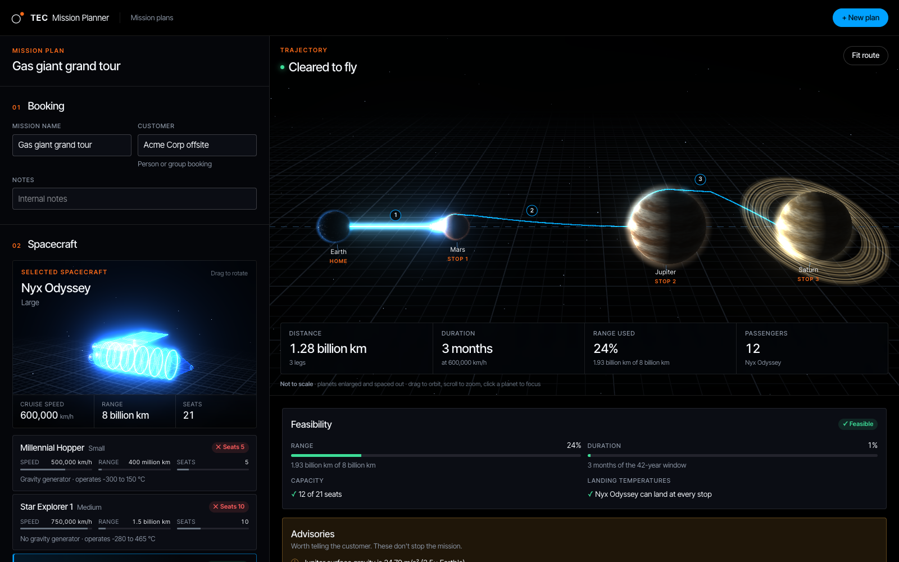

# Mission Planner

A prototype for TEC's travel agents to plan multi-planet tourist missions during the 2041 planetary alignment, when every planet sits on one line and stays put for about 42 years.

An agent picks a spacecraft, sets the number of passengers, and builds a route from Earth. As they go, the app calculates the trajectory: the shortest path, which flies around any planet in the way and departs from wherever the ship landed. It then shows the distance, duration, and range used, and whether the mission is feasible. Plans can be saved, reopened, duplicated, and deleted. Infeasible plans can be kept as drafts while the agent works it out with the customer.



## What an agent can do

- **Choose a spacecraft.** Each one shows its seats, speed, range, gravity generator, and operating temperatures, plus whether it can fly the current route (e.g. "Out of range", "Can't land on Venus").
- **Set the passengers.** The count is kept within the spacecraft's capacity, and the planner shows how the load shortens the ship's reach (`R = 1 + 0.042 × passengers` per km).
- **Build the route.** Add, reorder, and remove stops. The same planet twice in a row is blocked, the Sun isn't offered, and planets the spacecraft can't land on are flagged with the reason.
- **See the mission live.**
  - A 3D view of the route (a 2D side view where WebGL isn't available).
  - Feasibility checks with suggestions, e.g. "Exceeds range by 2%. Reduce to 20 passengers or choose Serenity XL."
  - Warnings that don't block the trip, such as high surface gravity.
  - A leg-by-leg flight plan.
- **Save and load plans.** Save, edit, duplicate, and delete (with confirmation). The list of saved plans can be searched by mission name or customer. Leaving a plan with unsaved changes asks first.

## Quick start (Docker)

Requires Docker with Compose.

```bash
docker compose up --build
```

Then open **http://localhost:5173**.

This starts PostgreSQL, the Rails API, and the web app. On start, the API creates and migrates the database, loads the planet and spacecraft data from [`data/data.yml`](data/data.yml), and adds four sample mission plans.

| Service | URL |
|---|---|
| Web app | http://localhost:5173 |
| API | http://localhost:3000/api |
| PostgreSQL | `localhost:5433` (user `postgres`, password `postgres`) |

## Manual setup

Requires Ruby 3.4.10, Node.js 22.12 or newer, and PostgreSQL 16 or newer running locally.

**API** (in one terminal):

```bash
cd api
bundle install
bin/rails db:prepare   # creates and migrates the database, then loads the data and sample plans
bin/rails server       # http://localhost:3000
```

By default Rails connects to the local PostgreSQL as your user. To use a different server or user, set the `DB_*` variables below.

**Web app** (in another terminal):

```bash
cd web
npm install
npm run dev            # http://localhost:5173
```

The web app's dev server forwards `/api` requests to `http://localhost:3000`.

### Configuration

| Variable | Default | Used by | Purpose |
|---|---|---|---|
| `MISSION_DATA_PATH` | `data/data.yml` at the repository root | API | The planet and spacecraft data file |
| `DB_HOST`, `DB_PORT`, `DB_USER`, `DB_PASSWORD` | Local PostgreSQL, your user | API | Database connection |
| `CORS_ORIGINS` | `http://localhost:5173` | API | Comma-separated origins allowed to call the API directly |
| `API_PROXY_TARGET` | `http://localhost:3000` | Web | Where the dev server forwards `/api` |
| `VITE_USE_POLLING` | unset | Web | Set to `true` where file changes don't trigger reloads (e.g. Docker on macOS) |

## Running the tests

**Locally:**

```bash
cd api
RAILS_ENV=test bin/rails db:create db:schema:load   # first time only
bundle exec rspec                                  # 229 examples
bin/rubocop

cd ../web
npm test                                           # 80 tests
npm run lint
npm run build                                      # type-checks, then builds
```

**In Docker**, with the stack running:

```bash
docker compose exec -e RAILS_ENV=test api bin/rails db:create db:schema:load   # first time only
docker compose exec api bundle exec rspec
docker compose exec web npm test
```

Create the test database with `db:create db:schema:load`, not `db:prepare`: `db:prepare` also loads the seed data, and the tests expect an empty database.

## Using a different data file

All YAML access goes through one loader, so swapping the data is a single step:

```bash
cd api
MISSION_DATA_PATH=/path/to/new.yml bin/rails db:seed
```

- **New or changed records** are added or updated, matched by a slug made from the name. Running the seed again changes nothing.
- **Fields the app doesn't know yet** are kept in an `extra_attributes` column, so no data is lost.
- **Invalid data** is rejected before anything is written. Every problem is listed with its record and field, e.g. `planets[3] (Earth): diameter_km is missing`, and the app keeps running on the previous data.
- **Records missing from the new file** are kept, since saved plans may use them.

The file has two lists, `planets` (the Sun included) and `spacecrafts`. Required fields:

| List | Required fields | Optional fields |
|---|---|---|
| `planets` | `name`, `type` (`Planet` for destinations, `Star` for the Sun), `diameter_km`, `distance_from_sun_km`, `average_temperature_c`, `gravity_m_per_s2`, `radiation_levels_msv` | `potentially_habitable`, `weather_patterns`, `moons` |
| `spacecrafts` | `name`, `capacity`, `range_km`, `travel_speed_km_per_hour`, `gravity_generator`, `operational_temperature_c_min`, `operational_temperature_c_max` | `size`, `mass_kg` |

The file must also include a planet named `Earth`, since every mission starts there, and no two bodies may overlap.

## How routes are calculated

Every planet's centre lies on one line, so the problem can be flattened to 2D without changing any distance: each body, the Sun included, is a circle on the x-axis.

The shortest path around round obstacles is like a string pulled tight around them: straight lines that just touch a planet, plus arcs along its surface. So for each leg, the API collects the points where such lines touch the planets, connects the ones that can see each other without cutting through a planet, and runs Dijkstra's shortest-path search to the nearest point on the target's surface.

Legs are chained: the first leaves Earth from the point facing the first destination, and each later leg departs from exactly where the previous one landed. That is why Earth → Mars → Jupiter flies about 5,300 km around Mars: the ship lands on the side facing Earth, and Jupiter is on the far side.

Range used is `distance × (1 + 0.042 × passengers)`, and duration is `distance ÷ speed`. A mission is checked against:

- **Problems that make it infeasible:** capacity, range, the 42-year alignment window, landing temperatures, and the route itself (it must start at Earth, have a destination, never repeat a planet back to back, and never land on the Sun).
- **Warnings that don't:** high surface gravity, high radiation, and a long mission on a spacecraft without a gravity generator. The thresholds are in [`api/config/advisories.yml`](api/config/advisories.yml).

More detail is in [docs/ALGORITHM.md](docs/ALGORITHM.md).

## Decisions and assumptions

The brief leaves a lot open by design. Every decision made where it does is listed with its reason in [docs/ASSUMPTIONS.md](docs/ASSUMPTIONS.md), marked as either awaiting confirmation from TEC or a design decision of ours. The main ones:

- **Landing temperatures:** a spacecraft may only land where the planet's average temperature is within its operating range. Flying past is fine. (#16)
- **Drafts:** infeasible plans can be saved; only a malformed route (no destination, not starting at Earth, a planet twice in a row) blocks saving. (#10, #28)
- **The Sun is an obstacle** but never a destination. (#1, #17)
- **"Maximum efficiency" is applied per leg:** each leg is the shortest path from where the ship landed. Choosing landing points to shorten the whole mission is listed under next steps. (#38)

## API

All endpoints are under `/api` and use JSON. Every error response has the shape `{ "errors": [{ "field": ..., "message": ... }] }`: 422 for invalid input, 404 for a missing record.

| Method and path | What it does |
|---|---|
| `GET /planets` | Every body, the Sun included, with its details and whether it can be a destination |
| `GET /spacecraft` | Every spacecraft, with the planets it can land on |
| `POST /mission_calculations` | Calculates a mission without saving it. Body: `{ spacecraft_id, passenger_count, planet_ids }` |
| `GET /mission_plans` | Saved plans, most recently updated first |
| `POST /mission_plans` | Saves a new plan |
| `GET /mission_plans/:id` | One plan, with a fresh calculation |
| `PATCH /mission_plans/:id` | Updates a plan; leaving out `planet_ids` keeps the route |
| `DELETE /mission_plans/:id` | Deletes a plan |
| `POST /mission_plans/:id/duplicate` | Copies a plan as "<name> (copy)" |

## Project structure

```
mission_planner/
├── api/                     Rails 8.1 API
│   ├── app/domain/          The calculation in plain Ruby: geometry, trajectories, missions (no database access)
│   ├── app/services/        Loading the data file, saving plans, running calculations from database records
│   ├── app/models/          Planet, Spacecraft, MissionPlan, MissionStop
│   ├── app/controllers/api/ JSON endpoints
│   ├── app/serializers/     JSON shapes
│   └── spec/                RSpec tests
├── web/                     React + TypeScript (Vite)
│   ├── src/api/             Typed API client, Zod schemas of the responses, TanStack Query hooks
│   ├── src/planner/         The planner: spacecraft, passengers, route, feasibility, flight plan, route views
│   ├── src/gl/              The 3D views (three.js)
│   └── src/views/           The two pages: mission plans and the planner
├── data/data.yml            TEC's planet and spacecraft data
├── docs/                    Assumptions and algorithm notes
└── docker-compose.yml
```

## Troubleshooting

- **Port 5173 or 3000 is already in use:** stop the other app, or change the left-hand port numbers in [`docker-compose.yml`](docker-compose.yml).
- **The web app fails after pulling new frontend packages:** the web container keeps its installed packages in a Docker volume. Recreate it:
  ```bash
  docker compose down
  docker volume rm mission_planner_web_node_modules
  docker compose up --build
  ```
- **Code changes don't show in the browser (Docker):** run `docker compose restart web`.

## Next steps

- **Whole-mission trajectory optimisation:** choose each landing point to minimise the total distance rather than each leg on its own. Earth → Mars → Jupiter would be 1,935 km shorter by landing on top of Mars. This needs the trajectory calculator to accept a free landing point, and the mission calculator to optimise all legs together.
- **Authentication and per-agent access,** so each agent signs in and sees their own plans.
- **Continuous integration and deployment,** running the test suites and linters on every change.
- **Customer records and pricing,** in place of the free-text customer name.
- **Itinerary suggestions:** a shorter stop order, or the most scenic route, using the planet data (moons, notable weather).
- **Caching legs:** each leg depends only on its start point and target, so results can be cached once the app tries many routes at once.
- **Server-side search** of saved plans, once there are too many to load at once.
- **More realism:** planetary motion after the alignment window, gravity, and real orbital mechanics.
