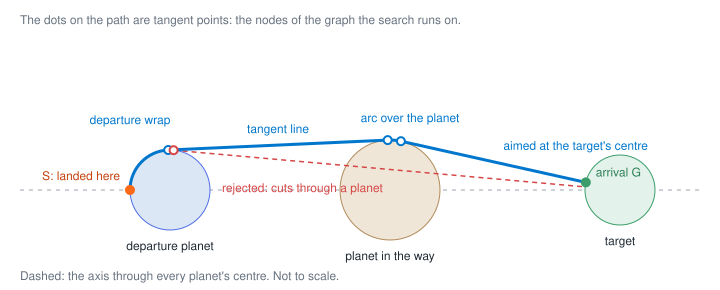

# How routes are calculated

This explains how Mission Planner turns a route (Earth, then the agent's stops) into a trajectory, and why. The code is in [`api/app/domain/`](../api/app/domain): plain Ruby with no database access, so it can be tested on its own.

## The problem

The brief's rules that shape the path:

- Planets are solid, perfect spheres; distances from the Sun are measured centre to centre.
- The first departure from Earth is from the point closest to the destination.
- A planet is visited once any point on its surface is reached.
- We always depart from the same point we arrived at.
- We must pass around any planet in our path. Gravity and other forces are negligible, so paths are pure geometry.
- The trajectory is optimised for maximum efficiency. Range used and duration both grow with distance, so this means the **shortest path**.

So each leg asks: *what is the shortest path from where the ship is now to any point on the next planet's surface, without passing through any planet?*

## Why it reduces to 2D

During the alignment, every planet's centre lies on one straight line. The whole set of spheres is therefore symmetric around that line: rotating a path around it changes neither its length nor whether it hits a planet. Any path can be rotated, piece by piece, into a single flat half-plane through the line without getting longer.

So the calculation works in 2D:

- Each body is a **circle on the x-axis**: centre at `distance_from_sun_km`, radius `diameter_km ÷ 2`. The Sun is included, at the origin.
- Paths are worked out **above the axis** (y ≥ 0). The mirror image below is equally short, and the one above is always shown ([assumption #15](ASSUMPTIONS.md)).

## One leg: a visibility graph and Dijkstra

The shortest path around round obstacles is like a string pulled tight around them. It is made of only two kinds of piece:

- **straight lines that just touch a circle** (tangent lines), and
- **arcs along a circle's surface**, between two touching points.

It only ever bends where it touches a circle. So the only points that matter are the touching points, and the problem becomes a shortest path through a small graph of them ([`trajectory_calculator.rb`](../api/app/domain/trajectory_calculator.rb)):



1. **Obstacles:** every body except the target, **including the planet the ship is leaving**. The ship can't fly through the planet it's standing on.
2. **Nodes:** the start point, plus touching points on every obstacle ([`tangents.rb`](../api/app/domain/geometry/tangents.rb)):
   - the tangent points as seen from the start;
   - the tangent points as seen from the **target's centre**, where the final approach leaves an obstacle;
   - the endpoints of every common tangent line (outer and inner) between each pair of obstacles.

   Nodes below the axis are dropped.
3. **Edges:**
   - **Straight:** between two nodes on different circles, if the line doesn't enter any circle ([`segment.rb`](../api/app/domain/geometry/segment.rb)). Cost: its length.
   - **Arc:** between neighbouring nodes on the same circle, going over the top. Cost: radius × angle.
   - **Goal:** from any node, straight at the target's centre, stopping at its surface: the arrival point `G`. Only allowed if the line is clear. Once you're in sight of a round target, the shortest way to reach its surface is straight at its centre.
4. **Search:** Dijkstra's shortest-path algorithm from the start; the cheapest node-plus-goal-edge wins. The route is then rebuilt as `Line` and `Arc` segments.

The result also records the planets the path touched on the way (`bypassed`) and how far it travelled around the departure planet before leaving it (`departure_wrap`).

**Size:** with 9 bodies, the graph has about 100 nodes. Checking every pair for a clear line dominates the cost, at roughly 80 ms per leg in Ruby. That's fine for interactive use.

## A mission: chaining legs

[`mission_calculator.rb`](../api/app/domain/mission_calculator.rb) chains the legs:

- **Leg 1** starts on Earth's surface at the point facing the first destination (on the axis, towards it).
- **Each later leg** starts exactly where the previous one arrived.
- **Per leg:** `range used = length × (1 + 0.042 × passengers)` and `duration = length ÷ speed`.

Then the mission is checked. *Violations* make it infeasible: capacity, range, the 42-year window, landing temperatures, and a malformed route. *Advisories* are warnings only: high gravity, high radiation, and a long mission without a gravity generator.

Each leg is the shortest from where the ship landed. Landing spots are not chosen to shorten the mission as a whole ([assumption #38](ASSUMPTIONS.md)); see [Limits](#limits-and-next-steps).

## Why the departure wrap dominates

Two kinds of detour add distance, and at real scale they differ by orders of magnitude. Real figures from the API:

| Detour | Example | Extra distance |
|---|---|---|
| Flying over a planet that is merely **in the way** | Earth → Jupiter, over Mars | **84 m** |
| | Earth → Neptune, over Jupiter and Saturn | **4.5 km** |
| Flying around the planet **you just landed on** | Earth → Mars → Jupiter, around Mars | **5,324 km** |
| | Earth → Jupiter → Saturn, around Jupiter | **109,745 km** |

**A planet in the way costs almost nothing.** The path only has to rise by the planet's radius `h`, over distances `a` and `b` of hundreds of millions of km on either side. The extra length is about

```
h² / 2 × (1/a + 1/b)
```

For Mars between Earth and Jupiter: `3,389.5² / 2 × (1/78.3M + 1/550.6M) ≈ 0.084 km`, which is exactly the 84 m above. The detour shrinks with the square of a tiny ratio.

**Wrapping the planet you landed on costs a large share of its circumference.** A ship arriving from Earth lands on the side of Mars facing Earth. If the next stop is further out, it must travel over Mars's surface until a straight line to the target is clear: about a quarter of the way round, `r × (π − acos(r/d)) ≈ r × π/2`. That grows with the planet's radius, not with any tiny ratio, which is why it's 5,324 km for Mars and nearly 110,000 km for Jupiter.

So at real scale, almost all of the detour cost comes from the rule *"we always depart from the same point we arrived at"*. Two practical consequences:

- **Stop order matters.** Doubling back past a planet you just landed on is where routes lose distance.
- **Where you land matters more than what's in the way.** That's why choosing landing points for the whole mission (below) is the most valuable next improvement.

## Numbers and precision

- **Tolerance:** a line counts as clear if it stays at least `radius × (1 − 1e-6)` from a planet's centre. At real scale (coordinates up to 4.5 × 10⁹ km) this absorbs floating-point noise without letting a path through: about 3 m for Mars.
- **Testing at two scales:** real detours are too small to reveal geometry mistakes, so the tests also use made-up planets about 100 units apart with radius about 30, where every expected length can be worked out by hand.
- **One known effect of the tolerance:** on Mars → Jupiter, the path can leave Mars from a neighbouring node about 40 m of arc early. The total distance is unaffected (it ties to within 10⁻⁷ km), so it is documented in the test rather than hidden.

## How it's tested

- **Exact answers on small layouts:** no obstacle, one obstacle, a small planet hidden behind a big one, starting on the far side, reversing direction, and grazing a planet. Each length is compared with a hand formula to within 10⁻⁹.
- **Reference values from the real data:** Earth → Mars is 78,290,239.5 km; Earth → Jupiter goes round Mars and is only metres longer than a straight line; Nyx Odyssey to Neptune fits 20 passengers but not 21.
- **Properties that must always hold:** points sampled along every path never fall inside a planet; legs are continuous; each arrival lies on the target's surface; each leg starts where the previous one ended.

## How it's drawn

At true scale every planet would be far smaller than a pixel, so the views use a schematic, not-to-scale layout: planets spread out on a blend of even and logarithmic spacing, and enlarged. The browser **never recalculates a path**. It maps the API's segments onto the layout ([`schematic.ts`](../web/src/planner/schematic.ts)):

- Within a planet's own span the mapping is a uniform scale, so landing points, arcs, and departure wraps fall exactly on the drawn circles.
- Straight segments are drawn as straight lines between their mapped ends, so they never bulge.
- Because drawn planets are so much bigger than real ones, a line that clears a planet in reality can clip its drawing. Such lines are bent over the drawn circle. This changes only the picture: which planets a leg touches, and every number, still come from the API.

## Limits and next steps

- **Whole-mission optimisation:** choose each landing point to minimise the total distance, not each leg on its own. On Earth → Mars → Jupiter, landing on top of Mars costs about 3,390 km more on the first leg but saves the 5,324 km wrap, 1,935 km in all. It needs the trajectory calculator to accept a free arrival point, and the mission calculator to optimise all legs together, e.g. a coarse search over landing angles, then local refinement.
- **Caching legs:** a leg depends only on its start point, target, and the catalog, so its result can be cached. That matters once the app tries many routes at once, e.g. suggesting a better stop order.
